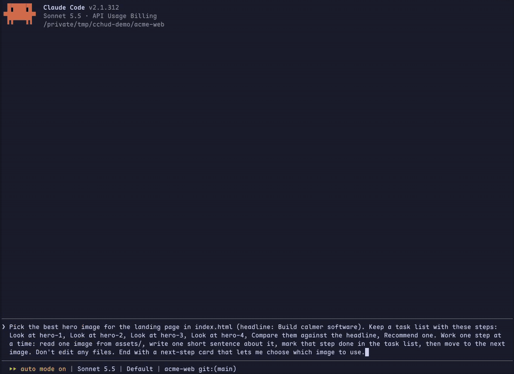
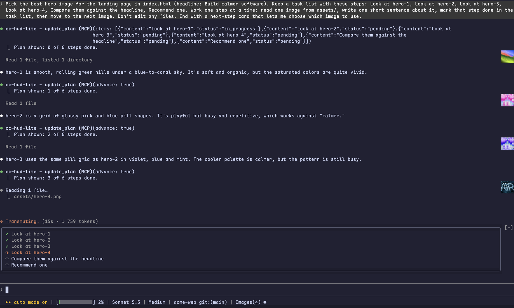
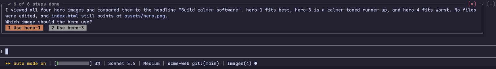
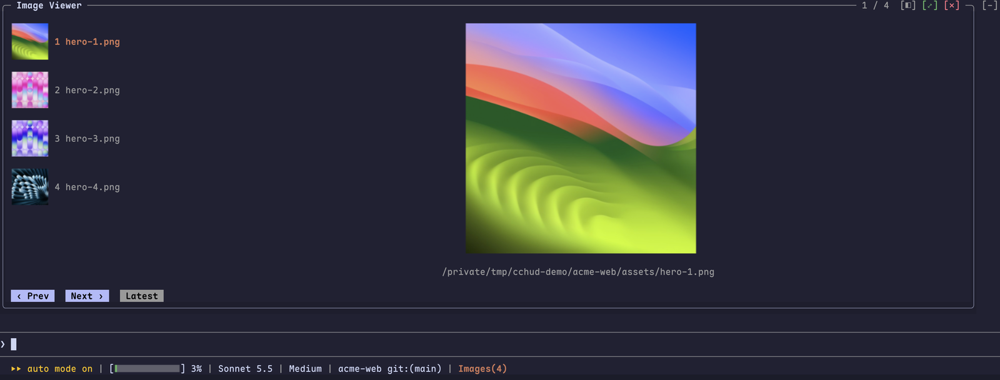
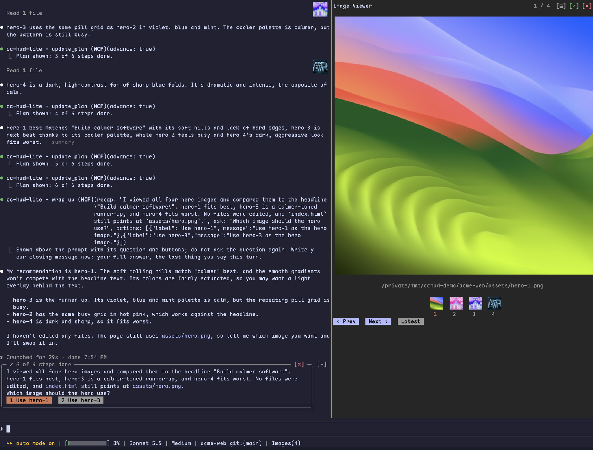
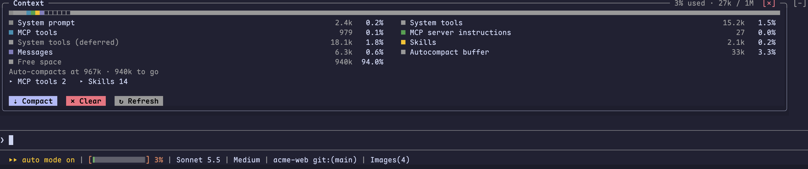
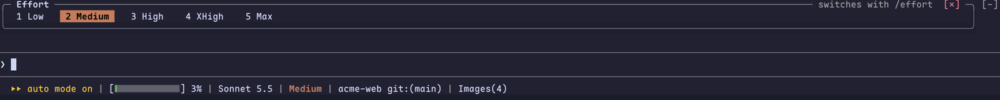
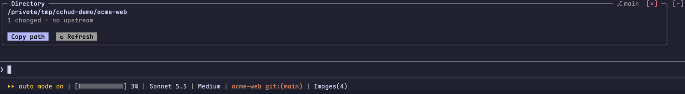

# cc-hud-lite

[English](README.md)

**把 Claude Code 桌面端的任务清单、下一步卡片、上下文面板和图片查看器，搬进你的终端。**



cc-hud-lite 是一个 Claude Code mod：只有一个 hooks 模块，不用构建，也不用额外安装任何东西。它在输入框下方加一条可点击的状态栏，并在输入框上方打开各个面板。每个面板是一个圆角框，标题和按钮嵌在上边框里，和 Claude Code 自己的 `[-]` 在同一行。

## 安装

在 shell 里执行（你自己，或者能执行命令的编程 agent 都行）：

```bash
claude plugin marketplace add lz-freedom/cc-hud-lite
claude plugin install cc-hud-lite@cc-hud-lite
claude plugin list
claude "/cc-hud-lite:setup"
```

`claude plugin list` 里应该能看到 `cc-hud-lite@cc-hud-lite` 已启用。最后一条会打开一个 Claude Code 会话并运行设置：检查 Claude Code 版本、你的终端能不能显示图片，并提出需要的那一项设置。这一步可选：不跑也都能用，只是图片可能显示成 `▣`。

## 功能

### 可以点击的状态栏

在输入框下方：上下文占用（进度条和百分比）、模型、思考程度（effort）、目录和 git 分支，以及对话里的图片数。点击某一项，在输入框上方打开对应面板，再点一次关闭。如果 Claude 网关报告了消费上限，也会显示出来。


### 实时任务清单，图片显示在对应步骤旁

Claude 干活时，任务清单固定在输入框上方：已完成的步骤是绿色 ✔，正在做的那步是橙色并带转圈动画，其余在等待。工具返回的每张图片都会以缩略图显示在对应记录的右侧，点一下就在图片查看器里打开。



### 需要做选择时的下一步卡片

需要你做决定的回合，结束时会给出简短总结、问题和回复按钮。点按钮，或在输入框为空时按对应数字，就会发出那条回复；`[✕]` 收起卡片。没有选择要做的回合不显示卡片。



### 图片查看器

对话里的所有图片，选中的那张放大显示，下方是它的路径。点缩略图或它的编号就切到那张图，也可以用 Prev、Next、Latest 翻。`[◧]` 把列表放在左侧，每一项是缩略图加旁边的文件名；`[⬓]` 把列表放在底部，是一排缩略图，编号在各自正下方。`[⤢]` 把查看器放大成对话旁边的大面板，再点一次放回；`[✕]` 关闭。





### 上下文详情

按类别列出上下文占用、自动压缩的触发点，以及 MCP 工具、记忆文件、agent 和 skill 列表，带 Compact、Clear、Refresh 按钮。



### 模型、思考程度和目录

点击或按数字，从 `modelPicker` 列表（或 Opus、Sonnet、Haiku 别名）里选模型、选 effort 档位，mod 替你执行 `/model` 和 `/effort`。目录面板显示当前会话所在目录、分支、上游和改动文件数，带 Copy path。





## 终端支持

| 终端 | 图片（进度条、缩略图、查看器） |
| --- | --- |
| kitty、Ghostty | 支持 |
| iTerm2 3.5+ | 需要在 `~/.claude/settings.json` 里设置 `"tui": "fullscreen"` |
| Orca | 需要同上的全屏设置，再加 `CLAUDE_CODE_FORCE_TERMINAL_IMAGES=1`：Orca 能画图片，但 Claude Code 还认不出它。`/cc-hud-lite:setup` 会提议把 `[ "$TERM_PROGRAM" = "Orca" ] && export CLAUDE_CODE_FORCE_TERMINAL_IMAGES=1` 加进你的 shell 配置文件。 |
| 其他 | 退回文字显示：进度条显示为 `■···`，缩略图显示为 `▣` |

其余功能在任何终端都能用。本页的截图都是在 Orca 里截的。

## 使用

| 操作 | 作用 |
| --- | --- |
| 点击状态栏的某一项 | 在输入框上方打开或关闭对应面板 |
| 点击对话记录旁的缩略图 | 在图片查看器里打开这张图 |
| 点击图片查看器里的缩略图或编号 | 切换到这张图 |
| 点击面板右上角的 `[✕]` | 关闭面板，或收起下一步卡片 |
| 输入框为空时按数字 | 选中当前面板或下一步卡片里对应编号的选项 |
| `/toolbar above`、`/toolbar below` | 把状态栏放到输入框上方，或放回输入框下方（默认） |

## 环境要求

- Claude Code 2.1.308 或更新版本，在终端里使用。桌面端有自己的任务清单和卡片，所以 mod 在桌面端不启用。
- 缩略图用 macOS 自带的 `sips` 生成。

## 说明

- 输入框上方区域右侧的 `[-]` 是 Claude Code 自己的折叠按钮：只要 mod 在那里画了东西它就会出现，mod 没法隐藏。面板标题就画在它那一行，嵌在框的上边框里，所以面板的按钮和 `[-]` 排成一排。状态栏放在输入框下方时，上方区域只在打开面板、任务清单或卡片时才会显示。
- 状态栏占用了 Claude Code 原来的提示行位置（`? for shortcuts`、`esc to interrupt`），权限模式会保留在它的左边。
- 第一次请求之前，effort 显示为 `Default`：mod 在请求发出之前读不到会话的档位。如果设置了 `CLAUDE_CODE_EFFORT_LEVEL`，整个会话都会被固定在这个档位，状态栏会显示 `(env)`，effort 面板也不提供切换。

## 开发

```bash
git clone https://github.com/lz-freedom/cc-hud-lite
claude --plugin-dir ./cc-hud-lite
claude plugin validate ./cc-hud-lite
claude plugin test ./cc-hud-lite
```

也可以设置 `CLAUDE_CODE_PLUGIN_DIRS=/path/to/cc-hud-lite`，让每个会话都加载它；交互式会话里改完保存就会自动热加载。引擎加载 mod 时会把 API 类型写到 `.claude-plugin/types/`，`tsc -p .` 就是用这些类型做类型检查。

## 许可证

[MIT](LICENSE)
